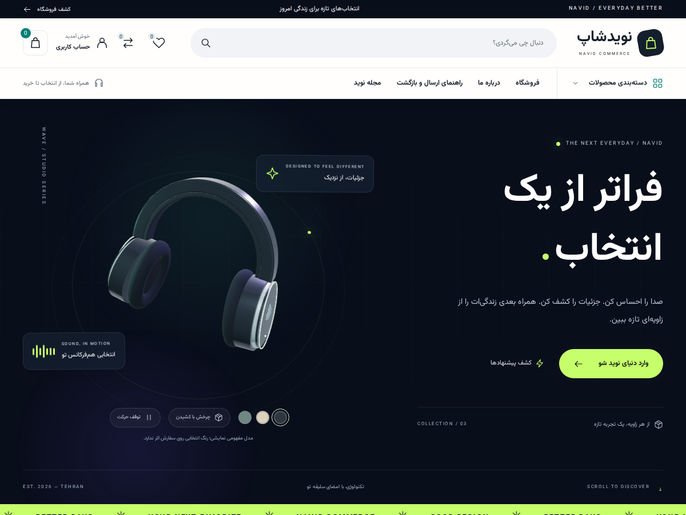

# نویدشاپ — Navid Studio 0.3.0

قالب فروشگاهی فارسی وردپرس و ووکامرس با صحنه سه‌بعدی واقعی، طراحی تازه و ابزارهای کاربردی خرید.

- [مشاهده فروشگاه ۰٫۳٫۰](https://playground.wordpress.net/?blueprint-url=https://raw.githubusercontent.com/promiseid/code/main/navid-commerce/playground/blueprint-0.3.0.json)
- [پیشخوان فارسی آزمایشی](https://playground.wordpress.net/?blueprint-url=https://raw.githubusercontent.com/promiseid/code/main/navid-commerce/playground/admin-0.3.0.json)
- [ZIP نصب قالب](navid-commerce-0.3.0.zip?raw=1)
- [راهنمای فارسی](README-fa.md)
- [نتیجه آزمون‌ها](TEST-REPORT-fa.md)

نام کاربری نمونه: `admin`، رمز نمونه: `NavidDemo!2026`. این حساب فقط در وردپرس مستقل مرورگر شما ساخته می‌شود. Playground هاست دائمی یا فروشگاه مشترک نیست. برای نگهداری تغییرات، از ذخیره/خروجی Playground استفاده کنید. آماده‌سازی اولیه وردپرس و ووکامرس معیار سرعت قالب نیست.

[نمایش حرکت واقعی مدل سه‌بعدی](design/studio-motion.webp)

## طراحی و حرکت

مدل اصلی با هندسه اختصاصی و Three.js ساخته شده است: نورپردازی، متریال فلزی، چرخش با ماوس/لمس و صفحه‌کلید، تغییر رنگ نمایشی، حالت توقف، حلقه‌های مداری و موج متحرک. مدل، تصویر مفهومی بنر است و انتخاب رنگ آن ویژگی سفارش را عوض نمی‌کند. منبع مدل در [design/product-scene.source.js](design/product-scene.source.js) موجود است.

Three.js 0.186.1 با مجوز MIT در بسته قرار دارد و در زمان اجرا از CDN دریافت نمی‌شود. حجم خام ماژول اختیاری حدود ۵۶۲ KiB است؛ در صفحه نخست دسکتاپ، پس از بارگذاری صفحه و هنگام قابل مشاهده بودن بنر دریافت می‌شود. در عرض حداکثر ۸۰۰ پیکسل، حالت کاهش حرکت و Data Saver، دریافت خودکار انجام نمی‌شود؛ دکمه «نمای سه‌بعدی» فعال‌سازی دستی را فراهم می‌کند. در نبود WebGL2، تصویر جایگزین و کل فروشگاه باقی می‌ماند. رندر در خروج از دید، زبانه پس‌زمینه یا توقف حرکت متوقف می‌شود. انیمیشن‌های بنر، موج، تصاویر کالکشن و تعامل کارت‌ها نیز کاهش حرکت سیستم را رعایت می‌کنند.

## ابزارهای خرید

- علاقه‌مندی تا ۲۰ محصول، مقایسه تا ۴ محصول و تاریخچه حداکثر ۸ بازدید، در همین مرورگر؛ بدون همگام‌سازی حساب.
- قیمت و موجودی فهرست‌ها با API عمومی WooCommerce تازه‌سازی می‌شود؛ بدون ایجاد API اختصاصی یا کلید دسترسی.
- جستجوی زنده حداکثر ۶ نتیجه، تأخیر کنترل‌شده و لغو درخواست قبلی؛ جستجوی معمول وردپرس هم برقرار است.
- فیلتر واقعی دسته، حداقل/حداکثر قیمت، موجودی و تخفیف، با فرم GET؛ مرتب‌سازی و صفحه‌بندی ووکامرس حفظ شده‌اند.
- پیش‌نمایش سریع، گالری بومی ووکامرس، محصول متغیر، سبد Ajax، حساب و سفارش‌ها، کوپن و تسویه‌حساب بومی؛ نوار سریع خرید به فرم واقعی محصول می‌رود.

متن و تصویر بنر، فعال بودن صحنه سه‌بعدی و ابزارها، بخش‌های صفحه نخست و نوار خرید از سفارشی‌ساز تنظیم می‌شوند. بارگذاری تصویر سفارشی، مدل مفهومی پیش‌فرض را کنار می‌گذارد.

این نسخه هنوز تأیید فروش تجاری راست‌چین یا ژاکت ندارد. اتصال درگاه و پیامک، سامانه لایسنس مارکت، سازنده کامل صفحات و چندفروشندگی پیاده نشده‌اند. آزمون روی هاست واقعی PHP/MySQL، درگاه هدف و ممیزی مستقل امنیت پیش از عرضه باقی است. طرح فیگمای ۰٫۱٫۰ سابقه قدیمی پروژه است؛ کد و پیش‌نمایش ۰٫۳٫۰ مرجع فعلی هستند.
